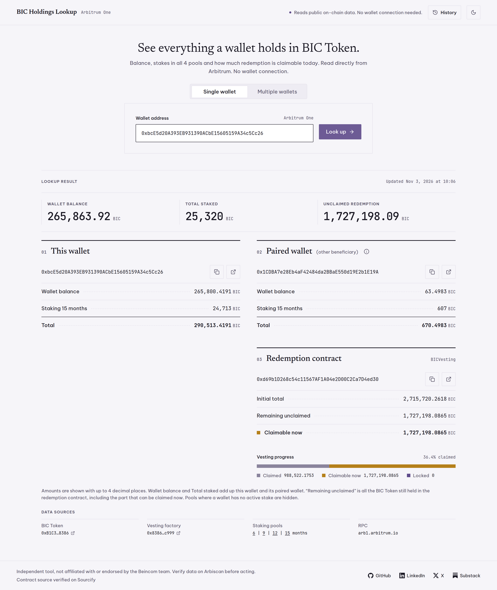
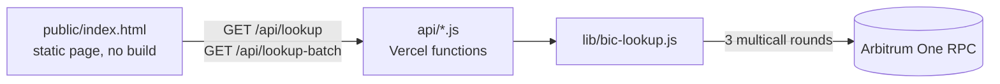

# BIC Holdings Lookup

[](https://github.com/holamhao/bic-holdings-lookup/actions/workflows/test.yml)
[](LICENSE)


Look up everything a wallet holds in BIC Token on Arbitrum One: its balance, its stakes in all four staking pools, and its redemption (vesting) contract with how much is claimable today. Check one address, or upload a spreadsheet of up to 1,000 and download the results as Excel. It reads public on-chain data only, so no wallet connection is needed.

**Live app: [biclookup.vercel.app](https://biclookup.vercel.app)**

<picture>
  <source media="(prefers-color-scheme: dark)" srcset="docs/images/lookup-dark.png">
  
</picture>

## Features

- **Full picture in one lookup.** Balance, active stakes per pool, and the redemption contract with its initial total, remaining unclaimed amount and the amount claimable now, drawn as a vesting progress bar.
- **Paired wallets.** A redemption contract has two beneficiaries. Looking up either one also shows the other wallet's holdings.
- **Batch lookup from a file.** Drop a `.csv` or `.xlsx` with one column of addresses. The file is parsed in the browser, and the result downloads as `.xlsx` with one row per input row, in order, including failed rows.
- **Lookup history.** Recent wallets and files are kept in the browser, with one-click re-lookup.
- **Light and dark themes**, a responsive layout down to phone width, and keyboard-accessible tabs and dialogs.
- **Google Forms integration.** An Apps Script checks each form response against a 20,000 BIC threshold ([guide](docs/google-form-integration.md)).

## How it works



A lookup is three sequential [Multicall3](https://www.multicall3.com/) rounds, each needing the previous result:

1. Token `symbol`/`decimals`, plus each wallet's redemption contract from the vesting factory.
2. For each distinct redemption contract: its beneficiaries, initial total, `releasable()` and remaining balance.
3. For every holder (entered wallets and the other beneficiaries): `balanceOf` plus deposits in every staking pool.

Each round is a single `eth_call`, whether it covers one wallet or fifty, which keeps a 1,000-wallet file at about 20 requests and 15 seconds on the free public RPC.

## Engineering notes

- **One runtime dependency.** The server uses [viem](https://viem.sh) and nothing else. The frontend is one static HTML file with inline CSS and native ES modules: no framework, bundler or build step.
- **Dependency-free spreadsheets.** [`public/batch-file.js`](public/batch-file.js) reads `.xlsx` by walking the zip central directory and inflating entries with the browser's `DecompressionStream`, then writes the result `.xlsx` with a small zip writer (CRC-32 included). The same module runs in the browser and in the Node tests.
- **Exact token math.** Amounts travel as decimal strings and are added and subtracted as `BigInt`, so 18-decimal values never pass through a lossy JS `Number`. The result file stores real numbers so every locale shows its own decimal separator; a CSV `12.345` would read as twelve thousand in a comma-decimal Excel.
- **One handler, two runtimes.** The API handlers use plain Node `req`/`res`, so the same files run as Vercel functions in production and under a small local [`dev-server.js`](dev-server.js).
- **Safe by construction.** DOM is built with `textContent` only, never `innerHTML`. [`vercel.json`](vercel.json) sets a strict Content-Security-Policy with `connect-src 'self'`, and text cells in the exported spreadsheet are inline strings, which a spreadsheet never evaluates as formulas.
- **Tested against mainnet.** The lookup tests run against live Arbitrum state with real contracts instead of mocks; file parsing, history and vesting math are covered by offline tests.

## Getting started

Requires Node.js 22 or later.

```bash
git clone https://github.com/holamhao/bic-holdings-lookup.git
cd bic-holdings-lookup
npm install
npm run dev     # http://localhost:3000 (set PORT to change)
npm test        # offline tests plus integration tests against live Arbitrum
```

The app uses the public RPC `https://arb1.arbitrum.io/rpc` by default. Set `ARBITRUM_RPC_URL` to use a keyed provider such as Alchemy or Infura; there is no other configuration.

To deploy your own copy, import the repo on [Vercel](https://vercel.com) with Framework Preset **Other** and no build settings. See the [deployment guide](docs/README.md#deploying-for-free-on-vercel-hobby-plan).

## API

| Endpoint | Returns |
|---|---|
| `GET /api/lookup?address=0x…` | `{ token, wallets[], redemption }`. `400` for an invalid address, `502` when the RPC fails |
| `GET /api/lookup-batch?addresses=0x…,0x…` | `{ token, results[] }` for up to 50 addresses, in input order. Invalid addresses come back as `{ input, error }` |

Token amounts are decimal strings already divided by `decimals`. Example:

```bash
curl "https://biclookup.vercel.app/api/lookup?address=0xbcE5d20A393EB931390ACbE15605159A34c5Cc26"
```

## Project structure

```
api/            HTTP handlers (Vercel functions): lookup.js, lookup-batch.js
lib/            Lookup logic, contract addresses and ABIs
public/         The static page and its browser modules (file I/O, history, vesting math)
test/           node:test suites, live and offline
integrations/   Google Apps Script for the Google Forms eligibility check
docs/           Technical reference and integration guide
```

## Documentation

- [Technical reference](docs/README.md): data sources, batch limits, history, UI, deployment and API details.
- [Google Forms integration](docs/google-form-integration.md): setting up the eligibility check.
- [CLAUDE.md](CLAUDE.md): architecture notes and invariants for AI coding agents, which double as a contributor guide.

## Disclaimer

An independent tool, not affiliated with or endorsed by the Beincom team. Figures are read live from the chain; verify them on [Arbiscan](https://arbiscan.io) before acting on them.

## License

[MIT](LICENSE) © Ho Lam Hao
